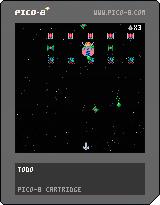

# Deluxe Galaga Remake (PICO-8)

Ein Shooter nach dem Vorbild von **[Deluxe Galaga](https://deluxegalaga.com/index.html)**
von Edgar M. Vigdal (1958–2015), für die Fantasy-Konsole
[PICO-8](https://www.lexaloffle.com/pico-8.php) WIP.

Viel Grafiken zu machen, nicht einfach den Stil der Aliens zu treffen bei der geringen Auflösung. 

**[▶ Im Browser spielen](https://callimero.github.io/dgalaga/)**

## Woher – Deluxe Galaga

*Deluxe Galaga* ist ein Shareware-Shoot'em-up für den **Commodore Amiga** aus
den 1990er-Jahren, geschrieben von dem Norweger **Edgar M. Vigdal**. Es nimmt
die Idee des Arcade-Klassikers *Galaga* (Namco, 1981) – Feinde fliegen in
Formation ein und stürzen sich einzeln drehend herab – und macht daraus
deutlich mehr: Extras und Waffen zum Kaufen, viele Level,
Meteoritenstürme. Verbreitet wurde es unter anderem über die Cover-Disks
von Zeitschriften; in der Liste „Top 100 Amiga Games of All Time“ steht es
auf Platz 19.

Um 1999 wandte sich Vigdal anderen Projekten zu, etwa *Warblade* für PC und
später iOS, einer Weiterentwicklung derselben Idee. Edgar M. Vigdal starb 2015.

## Legacy

Sein Spiel lebt weiter: Shane R. Monroe betreut seit 1999 als offizieller
„Custodian“ die Seite [deluxegalaga.com](https://deluxegalaga.com/index.html)
und hält das Spiel verfügbar. Dort gibt es inzwischen auch *Deluxe Galaga
Enhanced*, eine Neuübersetzung des originalen Assembler-Codes nach C für
Windows, Mac, Linux und den Browser – mit einem Modus, der exakt dem Original
entspricht, und einem mit Erweiterungen wie Breitbild.

**Pico Deluxe** ist eine kleine Verbeugung davor: kein Nachbau, sondern der
Versuch, das Gefühl von Formation, Sturzflug und Sternfeld in die engen
Grenzen von PICO-8 (128 × 128 Pixel, 16 Farben, 6 Tasten) zu bringen – und
dabei Lua wieder zu lernen. Grafisch wird das natürlich sehr rudimentär;
worauf es ankommt, ist das Spielgefühl, und das soll möglichst gut
eingefangen werden.

Wer das echte Spiel erleben will, braucht zum Glück weder einen Amiga noch
einen Emulator: Auf [deluxegalaga.com](https://deluxegalaga.com/index.html)
läuft es inzwischen sogar im Browser – in voller AGA-Pracht, dem Grafikmodus
der neueren Amigas (A1200/A4000).

## Stand

- Titel, Spiel als Zustände über `_update60=funktion`
- Sternfeld mit 100 Sternen in verschiedenen Tiefen (Tempo und Helligkeit),
  dunkles Grau aus der geheimen Palette
- Schiff mit Neigung beim Lenken
- **Schüsse wie im Original:** ein Magazin mit 3 Schüssen, je Tastendruck
  einer (Festhalten feuert nicht automatisch). Erst wenn es leer ist, lädt
  es nach – also gut haushalten.
- **Waffen:** Einzel-, Doppel- und Dreifachschuss; der Dreifachschuss
  fächert auseinander. Später als Extras, zum Testen mit ⬆️ umschaltbar.
- **Gegner als Objekte** mit drei Arten der Darstellung:
  - Flattern in der Formation (Bilder nach Zeit, jeder Gegner mit eigenem
    Takt und Startbild, damit die Formation nicht im Gleichschritt flattert)
  - Flug mit Blick in Flugrichtung
  - Sturzflug mit gleichmäßiger Drehung
  - 8 Richtungen aus nur 3 Sprites pro Gegner (gerade, schräg, seitlich)
    plus Spiegeln
- **Formation** aus roten, grünen und blauen Gegnern, die langsam hin und
  her pendelt. Ab und zu stürzt einer kreiselnd heraus, fliegt einen Bogen,
  kommt von oben zurück und reiht sich wieder ein.
- **Käfer** (2×2-Sprite) flattert über den Grünen und wirft „Säure“ –
  Plasmabälle mit grün verglühendem Schweif
- **Abschießen:** kleine Gegner brauchen einen Treffer, der Käfer mehrere
  (einstellbar) und blitzt bei jedem Treffer weiß auf. Explosion aus
  Sprite-Animation und Funken in der Farbe des Gegners.
- **Angriffswellen** mit 1, 1, 2, 2, 3, 3 … Angreifern gleichzeitig. Sie
  schießen wie im Original nur senkrecht nach unten, in Salven von 1–3
  Schüssen: beim Abtauchen und nach dem Kreisel im Sinkflug – bis knapp
  über das eigene Schiff. Ausweichen ist Pflicht (Treffer folgen noch).
- **Treffer auf das eigene Schiff** durch Schüsse und Säure: Explosion,
  ein Leben weniger, danach kurz blinkend unverwundbar; bei 0 Leben
  „game over“. Berührungen mit Aliens schaden nicht – wie im Original.
- **Große Gegner** schießen gezielt auf das Schiff, jeder mit eigenem Projektil
- **Sturzflug:** kreiselnd aus der Formation, schräg nach unten feuernd,
  manchmal mit Kreis im unteren Bildteil
- **Level** liegen als Daten in der Map der Cart (kostet keinen Code):
  Formation, bis zu 3 Ströme auf Bézierbahnen, auf denen die Aliens
  einfliegen und sich in ihre Plätze aufteilen. Große Aliens wandern frei
  in der oberen Hälfte, wechseln die Richtung und stoßen vor.
- **Bonusrunden** („bonus stage“ blinkt): Aliens kreuzen ohne zu schießen
- **Levelübergang** mit Stage, Punkten und Highscore; nach dem letzten
  Abschuss läuft das Level noch kurz weiter
- Lebensanzeige oben rechts (Punkte und Highscore kommen zwischen den Leveln)

## Geplant

- Einflug der Formation, Angriffe auf den Spieler
- Level-Editor als Webseite (lädt die Cart, zeigt die Level, Bahnen per
  Maus, Vorschau mit den echten Sprites)
- Extras (mehr Schüsse, Waffen)
- Level und Übergänge
- Meteoritensturm

## Steuerung

| Taste | Funktion |
|---|---|
| ⬅️ ➡️ | fliegen |
| ❎ | schießen |
| ⬆️ | Waffe wechseln (nur zum Testen) |

Im Browser: Pfeiltasten, **X** schießt.

## Dateien

| Datei | Inhalt |
|---|---|
| `index.html`, `index.js` | Web-Player (GitHub Pages) |
| `dgalaga.p8` | die Cart (in PICO-8: `load dgalaga`) |
| `dgalaga.p8.png` | dieselbe Cart als Bild-Datei |
| `dgalaga.lua` | der Quellcode zum Lesen |
| `tools/levels.py` | schreibt die Level in die Map (bis der Editor fertig ist) |

## Hinweis

Fan-Projekt ohne kommerzielle Absichten, nicht verbunden mit den Rechteinhabern
von *Deluxe Galaga* oder *Galaga* (Bandai Namco). Grafik und Code sind eigen,
nichts ist aus dem Original übernommen.
